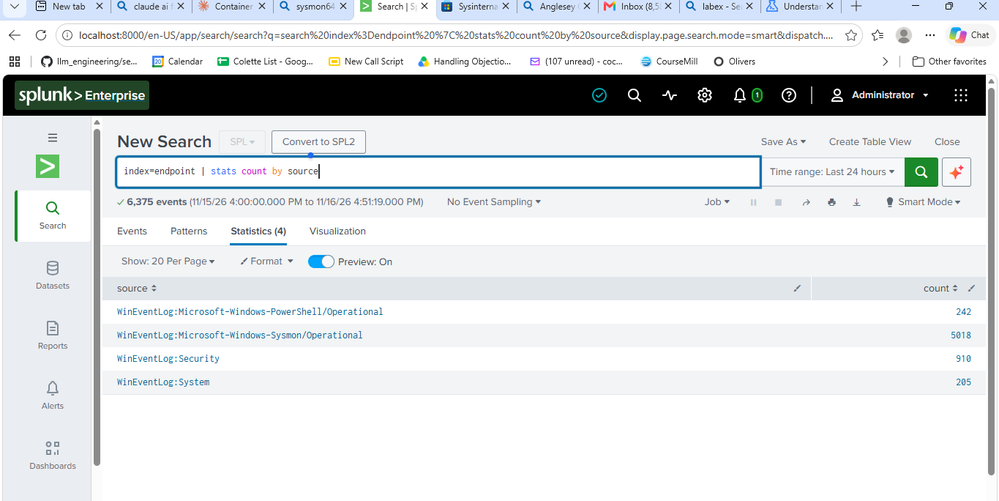
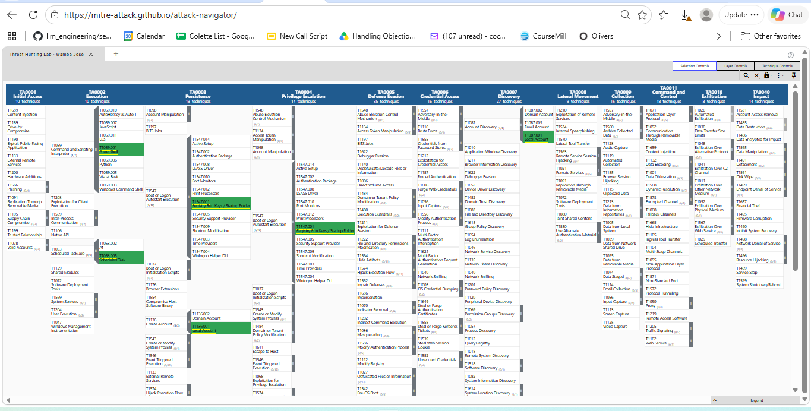
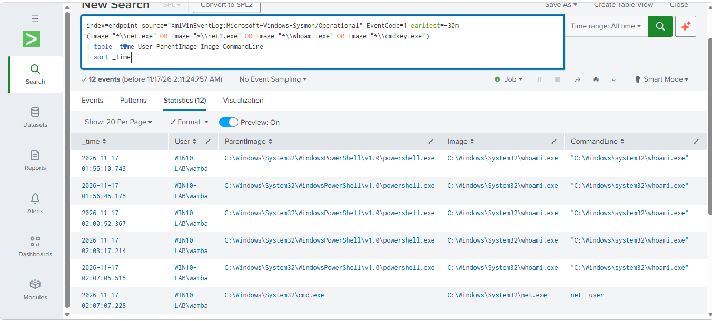
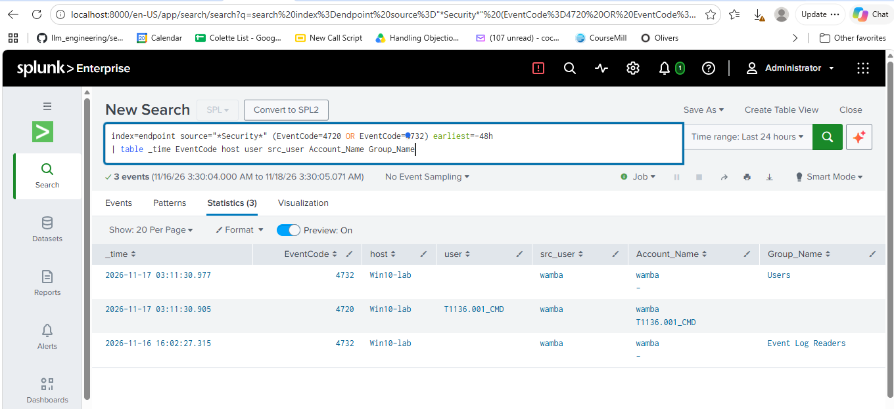
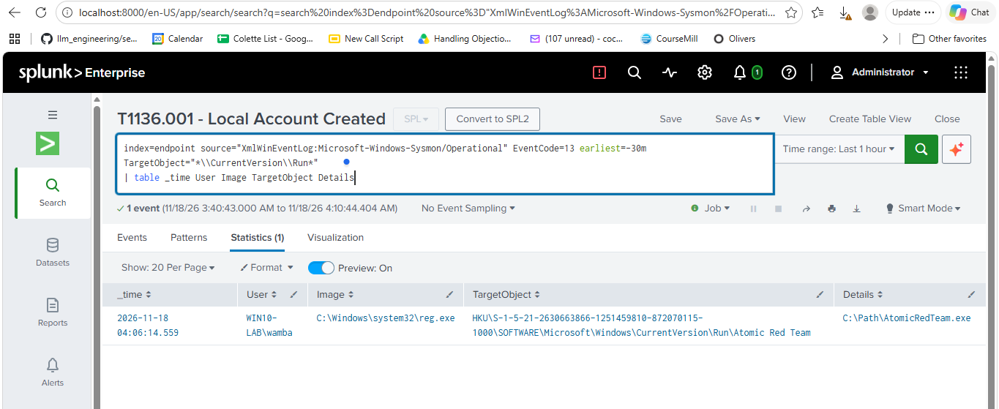
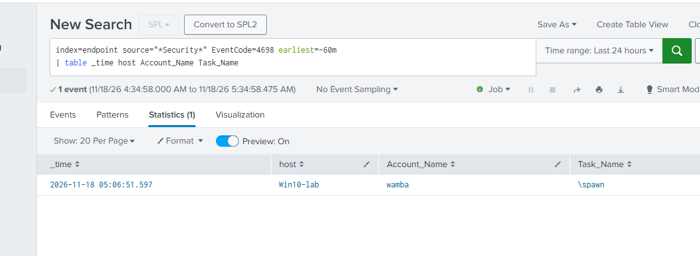
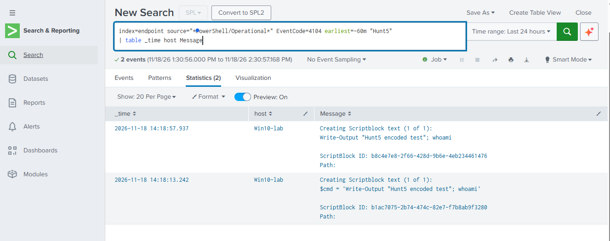

# 🎯 Threat Hunting with MITRE ATT&CK, Splunk, Sigma & Atomic Red Team

**Author:** Wamba José  
**Role focus:** SOC Analyst / Threat Hunter  
**Tools:** Splunk Enterprise (Docker) · Sysmon · Splunk Universal Forwarder · Atomic Red Team · Sigma · MITRE ATT&CK Navigator · VirtualBox

---

## 📌 Overview

In this home lab I emulated **five real attacker techniques** from the MITRE ATT&CK framework on a Windows 10 endpoint, then **hunted for them in Splunk**, confirmed each hypothesis with evidence from **two independent log sources**, and turned every finding into a reusable **Sigma rule** and a **scheduled Splunk alert**.

Each hunt follows the same hypothesis-driven method used by SOC threat-hunting teams:

```
Hypothesis → Emulate (Atomic Red Team) → Hunt (SPL) → Analyze → Sigma rule → Splunk alert → Cleanup
```

**Result:** 5 techniques emulated · 5 hypotheses confirmed · 5 Sigma rules · 5 scheduled alerts · 1 benign event investigated and closed.

---

## 🏗️ Lab Architecture

```
[ Windows host PC ]
   ├── Docker Desktop
   │     └── Splunk Enterprise container  ← SIEM (web UI :8000, receives logs on :9997)
   │
   └── VirtualBox
         └── Win10-lab VM  (Host-Only 192.168.160.150 + NAT for internet)
               ├── Sysmon (SwiftOnSecurity config)   ← endpoint telemetry
               ├── PowerShell Script Block Logging   ← decoded PowerShell (4104)
               ├── Splunk Universal Forwarder ──► 192.168.160.1:9997
               └── Atomic Red Team                   ← attack emulation
```

| Component | Details |
|---|---|
| SIEM | Splunk Enterprise in Docker, persistent volumes, custom index `endpoint` |
| Add-ons | Splunk Add-on for Microsoft Windows, Splunk Add-on for Sysmon |
| Log sources | Sysmon Operational, Windows Security, System, PowerShell Operational |
| Network | VirtualBox Host-Only network (192.168.160.0/24) for log forwarding |

**Why Docker for Splunk?** One-command deployment, isolation from the host OS, persistent volumes for data and configuration, and an easy reset if something breaks.



---

## 🗺️ ATT&CK Coverage

| # | Technique | Tactic | Data source | Severity |
|---|---|---|---|---|
| 1 | **T1087.001** Local Account Discovery | Discovery | Sysmon 1 | Medium |
| 2 | **T1136.001** Create Local Account | Persistence | Sysmon 1 + Security 4720/4732 | High |
| 3 | **T1547.001** Registry Run Keys | Persistence, Privilege Escalation | Sysmon 1 + 13 | High |
| 4 | **T1053.005** Scheduled Task | Persistence, Execution | Sysmon 1 + Security 4698 | High |
| 5 | **T1059.001** Encoded PowerShell | Execution | Sysmon 1 + PowerShell 4104 | High |



The Navigator layer is in [`attack-navigator/threat-hunting-layer.json`](attack-navigator/threat-hunting-layer.json) and can be opened at <https://mitre-attack.github.io/attack-navigator/>.

---

## 🔎 Hunts

### Hunt 1 — T1087.001 Local Account Discovery
**Hypothesis:** An attacker enumerating local accounts will run `net.exe`, `net1.exe`, `whoami.exe` or `cmdkey.exe`, often several within seconds.

**Findings:** `whoami.exe` launched by `powershell.exe`; `net user`, `net localgroup` and `cmdkey /list` launched by `cmd.exe`, all by `WIN10-LAB\wamba` within a few seconds.

**Detection logic:** 3+ distinct discovery commands in 5 minutes. **The scheduled alert fired automatically** after the emulation.



---

### Hunt 2 — T1136.001 Create Local Account
**Hypothesis:** A backdoor account will appear as `net user ... /add` in Sysmon and as Security Event **4720**.

**Findings:**
```text
cmd.exe  ->  net user /add "T1136.001_CMD" "T1136.001_CMD!"
   net.exe  ->  net1 user /add "T1136.001_CMD" "T1136.001_CMD!"
```
- Security **4720** (account created) and **4732** (added to Users) in the **same second** as the Sysmon event — cross-source correlation.
- The backdoor **password was visible in clear text** in the command line.

**Benign finding:** A 4732 event adding an account to `Event Log Readers` was traced to legitimate admin work (granting the Splunk forwarder log access) — **investigated and closed as benign**.



---

### Hunt 3 — T1547.001 Registry Run Keys
**Hypothesis:** Run-key persistence will produce Sysmon **EventCode 13** (registry value set) on `CurrentVersion\Run`, written by `reg.exe` (EventCode 1).

**Findings:** `cmd.exe → reg.exe REG ADD HKCU\...\CurrentVersion\Run /V "Atomic Red Team" /D C:\Path\AtomicRedTeam.exe`. The command (EventCode 1) and the registry write (EventCode 13) occurred **32 ms apart**. A baseline of legitimate Run values (OneDrive, Edge) was documented after cleanup.



---

### Hunt 4 — T1053.005 Scheduled Task
**Hypothesis:** A malicious task will show `schtasks.exe /create` in Sysmon and Security Event **4698**.

**Preparation:** Event 4698 is not logged by default — enabled with
`auditpol /set /subcategory:"Other Object Access Events" /success:enable /failure:enable`

**Findings:** `schtasks /create` created task `\spawn` running `cmd.exe`; Security 4698 confirmed the creation by `wamba` at the same time as the Sysmon event.



---

### Hunt 5 — T1059.001 Encoded PowerShell
**Hypothesis:** Encoded PowerShell will show `-EncodedCommand` in Sysmon, and Script Block Logging (**4104**) will reveal the decoded command.

**Findings:** `powershell.exe` spawned `powershell.exe -NoProfile -EncodedCommand VwByAGkA...` (unreadable). Script Block Logging recorded the decoded payload in clear text: `Write-Output "Hunt5 encoded test"; whoami`. **Obfuscation defeated.**



---

## 🛡️ Detections

| Technique | Sigma rule | SPL | Splunk alert |
|---|---|---|---|
| T1087.001 | [sigma](sigma-rules/T1087.001_local_account_discovery.yml) | [spl](spl-queries/T1087.001_local_account_discovery.spl) | Hourly · Medium |
| T1136.001 | [sigma](sigma-rules/T1136.001_create_local_account.yml) | [spl](spl-queries/T1136.001_create_local_account.spl) | Hourly · High |
| T1547.001 | [sigma](sigma-rules/T1547.001_registry_run_key.yml) | [spl](spl-queries/T1547.001_registry_run_key.spl) | Hourly · High |
| T1053.005 | [sigma](sigma-rules/T1053.005_scheduled_task_creation.yml) | [spl](spl-queries/T1053.005_scheduled_task_creation.spl) | Hourly · High |
| T1059.001 | [sigma](sigma-rules/T1059.001_encoded_powershell.yml) | [spl](spl-queries/T1059.001_encoded_powershell.spl) | Hourly · High |

Sigma rules are vendor-neutral and can be converted to Splunk, Microsoft Sentinel, Elastic and other SIEMs.

---

## 🧰 Troubleshooting I Solved

Real problems encountered and fixed while building the lab:

- **Duplicate IP on the Host-Only network** — the host itself had a stray 192.168.160.10; found with `Get-NetIPAddress` (`AddressState: Duplicate`) and removed.
- **Forwarder could not read the Sysmon log** (`errorCode=5`, access denied) — switched the service from the virtual account to `LocalSystem`.
- **No field extraction for XML Windows events** — installed the Splunk Add-ons for Windows and Sysmon; verified with `table EventCode Image CommandLine`.
- **Events invisible in time-bound searches** — VM clock drift after snapshot restore; fixed with `w32tm /resync`.
- **Firewall blocking log forwarding** — added inbound rules for TCP 9997 and the Docker backend.
- **Security 4698 missing** — enabled the audit subcategory with `auditpol`.

---

## 📁 Repository Structure

```
threat-hunting-mitre-attack/
├── README.md
├── screenshots/          # evidence for every phase and hunt
├── sigma-rules/          # 5 Sigma detection rules (.yml)
├── spl-queries/          # 5 Splunk detection searches (.spl)
├── attack-navigator/     # ATT&CK Navigator layer (.json)
└── report/
    └── findings.txt      # full threat hunting findings
```

---

## 💼 Skills Demonstrated

- Hypothesis-driven **threat hunting** mapped to **MITRE ATT&CK**
- **Adversary emulation** with Atomic Red Team
- **Splunk SPL**: filtering, `stats`, `bin`, `rex`, cross-source correlation
- **Detection engineering**: Sigma rules and scheduled SIEM alerts with severity
- **Windows telemetry**: Sysmon (1, 13), Security (4720, 4732, 4698), PowerShell (4104)
- **Log pipeline**: Universal Forwarder, `inputs.conf`, indexes, add-ons
- **Infrastructure**: Docker, VirtualBox networking, Windows firewall, audit policy
- **Triage**: separating malicious activity from benign admin activity

---

## ⚠️ Disclaimer

All attacks were run in an **isolated lab VM** for educational purposes. Passwords shown in screenshots are lab-only test values.
